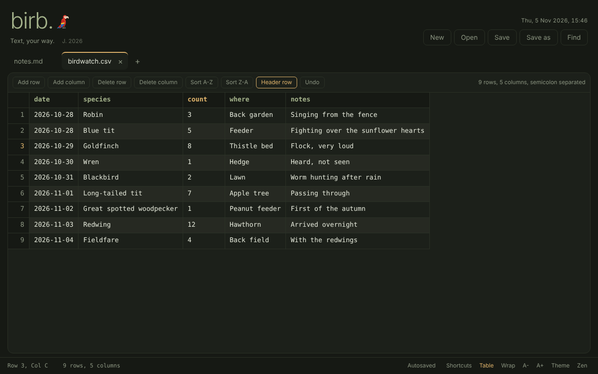

# birb.

A small, quiet text editor for Windows, macOS and Linux. Tabs, find and replace, and a table view for CSV files that saves them back exactly as it found them.



## Download

Get the file for your system from the [latest release](https://github.com/YOURUSER/birb/releases/latest).

| | |
| --- | --- |
| macOS | `Birb-…-mac-arm64.dmg` for Apple Silicon, `…-mac-x64.dmg` for Intel |
| Windows | `Birb-Setup-….exe` (installs for you, no admin needed) or `Birb-Portable-….exe` |
| Linux | `Birb-…-linux-x64.AppImage`, or the `.deb` for Debian and Ubuntu |

Birb is not code-signed yet, so your system will ask you to confirm the first launch.

- macOS: right-click Birb in Applications, choose Open, then Open again. If it says the app is damaged, run `xattr -dr com.apple.quarantine /Applications/Birb.app`.
- Windows: on the blue SmartScreen box, choose More info, then Run anyway.
- Linux: make the AppImage executable with `chmod +x`. On Ubuntu 24.04 and newer, if it will not start, run it with `--no-sandbox` or use the `.deb`.

## Using it

Open a `.csv` or `.tsv` and it appears as a table. The delimiter is detected (comma, semicolon, tab or pipe) and the file is saved back with the same delimiter and line endings. You can sort a column, add and delete rows and columns, turn the header row on or off, undo, and paste a block of cells from a spreadsheet.

Everything you type is autosaved, so closing and reopening Birb brings back all your tabs. There are dark and light themes, line numbers, word wrap and a zen mode. Birb makes no network connections.

| | |
| --- | --- |
| Save, Save as | `Ctrl+S`, `Ctrl+Shift+S` |
| Open | `Ctrl+O` |
| Find and replace | `Ctrl+F`, then `F3` and `Shift+F3` |
| New tab, close tab | `Alt+N`, `Alt+W` |
| Table view | `Alt+T` |
| Zen mode | `Alt+Z` |
| All shortcuts | `Alt+/` |

`Ctrl` is `Cmd` on a Mac.

## Command line

```sh
birb notes.txt data.csv        # open files
birb todo.md                   # a new file is created on first save
git log --oneline | birb -     # pipe text into a new tab
```

If Birb is already open, files appear as new tabs in the same window.

There are two ways to get the command.

The launcher is a small Node script (`bin/birb.js`) that finds your installed Birb. It supports everything above, including piping.

```sh
npm install -g github:YOURUSER/birb
```

From a checkout of this repository, `npm install && npm link` does the same. To point it at a particular copy of the app, set `BIRB_APP` to the full path of the executable.

The app can also be called directly, which opens files but cannot read a pipe:

- Linux `.deb`: installed as `birb`.
- macOS: `sudo ln -s /Applications/Birb.app/Contents/MacOS/Birb /usr/local/bin/birb`
- Windows: add `%LOCALAPPDATA%\Programs\Birb` to your PATH.

## Building from source

Requires [Node.js](https://nodejs.org) 20 or newer.

```sh
git clone https://github.com/YOURUSER/birb.git
cd birb
npm install
npm start          # run it
npm run dist       # build an installer for the system you are on, into dist/
```

The editor is a single self-contained file, `src/index.html`, and still works in an ordinary browser. `main.js` and `preload.js` add native file dialogs, file associations and the command line.

## Releasing

Change `version` in `package.json`, then:

```sh
git tag v1.0.1
git push --tags
```

GitHub Actions builds the Mac, Windows and Linux installers and attaches them to a new release. It takes about ten minutes.

## Licence

MIT
